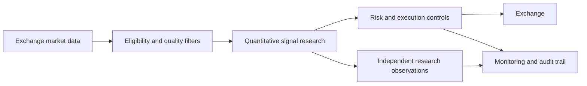

# Coinbase Crypto Momentum

### Systematic spot-market research and execution infrastructure

A Python-based quantitative research and execution project studying cross-sectional cryptocurrency momentum, market-regime filters, liquidity-aware security selection, and risk-managed Coinbase Advanced spot trading.

**This public project overview is intentionally documentation-only.** The execution engine, proprietary strategy parameters, credentials, account activity, and production infrastructure are maintained separately and are not distributed here.

## Research and engineering domains

- Dynamic cryptocurrency spot universe construction
- Multi-horizon relative momentum and trend filters
- Market-wide regime and breadth analytics
- Exchange connectivity and execution resilience
- Order protection, reconciliation, and operational monitoring
- Observation-only research streams and regression testing

## Architecture

## Scope and disclosure

The project is an independent research/software-engineering initiative. This public overview does **not** represent audited live performance, an investment product, an open-source code release, or a recommendation to trade. Trading can lead to substantial financial loss.

## Source availability

The project source is not distributed through this public overview. **GitHub does not provide a way to prevent downloading or copying files contained in a public repository.** Nothing in this public package purports to impose a technical download restriction.

© 2026. All rights reserved by the original project author.
