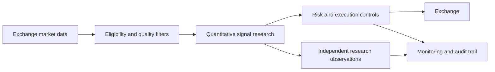

# Coinbase Crypto Momentum

### Systematic spot-market research and execution infrastructure

A Python-based quantitative research and execution project studying cross-sectional cryptocurrency momentum, market-regime filters, liquidity-aware security selection, and risk-managed Coinbase Advanced spot trading.

This repository contains a curated source release, synthetic tests, and an illustrative configuration. Credentials, account activity, local data, logs, and private operational state are not included. The example configuration defaults to observation mode and sets deployment allocation to zero; it is not a validated production configuration.

## Research and engineering domains

- Dynamic cryptocurrency spot universe construction
- Multi-horizon relative momentum and trend filters
- Market-wide regime and breadth analytics
- Exchange connectivity and execution resilience
- Order protection, reconciliation, and operational monitoring
- Observation-only research streams and regression testing

## Architecture

## Source and tests

- `src/crypto_momentum/` contains exchange integration, strategy, execution, monitoring, and supporting modules.
- `tests/` contains synthetic tests; no account or trading history is included.
- `.env.example` has blank credential fields and defaults to observation mode. `config/strategy.yaml` is an illustrative configuration with zero deployment allocation.
- `scripts/` and the Windows command files provide setup and supervision helpers.

For the test suite, use Python 3.11 or later, install `requirements.txt`, then run `python -m pytest`. The application requires separately supplied exchange credentials and market data for connected workflows. Keep any populated `.env` private. The source includes live-order functionality; do not use the example as a production deployment without independent review and validation.

## Scope and disclosure

This independent research/software-engineering project does not represent audited live performance, an investment product, or a recommendation to trade. Trading can lead to substantial financial loss.

## Source availability

The curated source and tests are publicly viewable; credentials, account information, and runtime data are not distributed. Public files can be copied or downloaded. No license is granted beyond any rights expressly stated in the accompanying notice.

© 2026. All rights reserved by the original project author.
